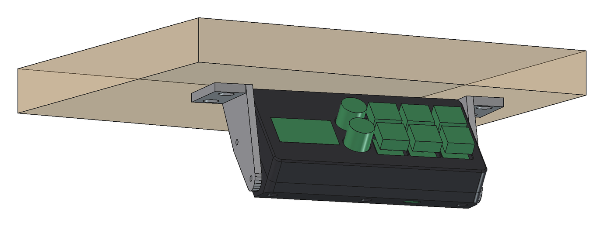
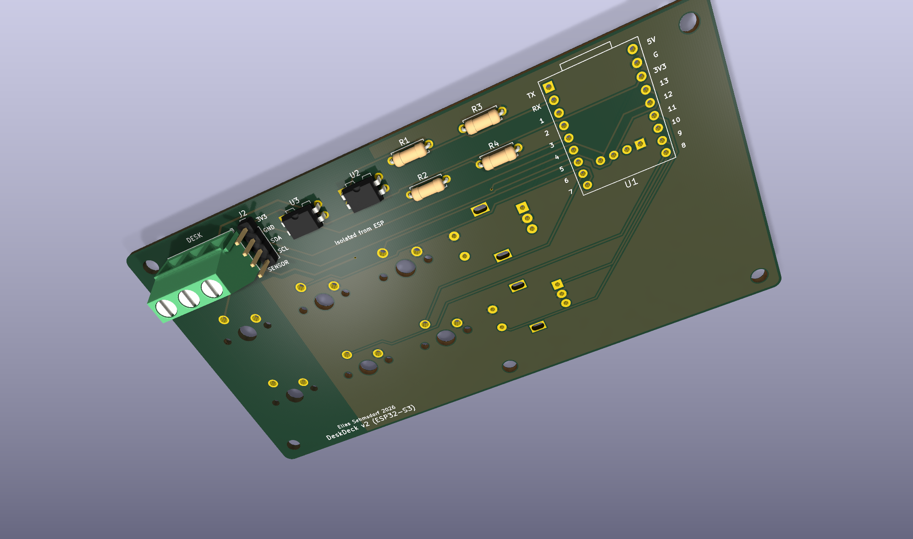
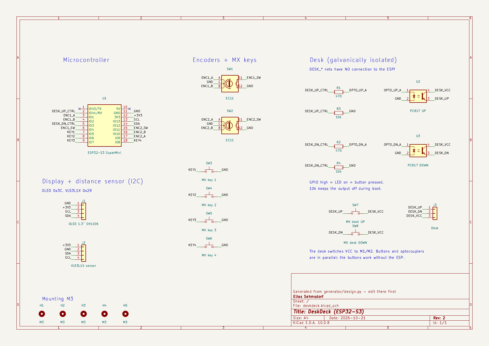
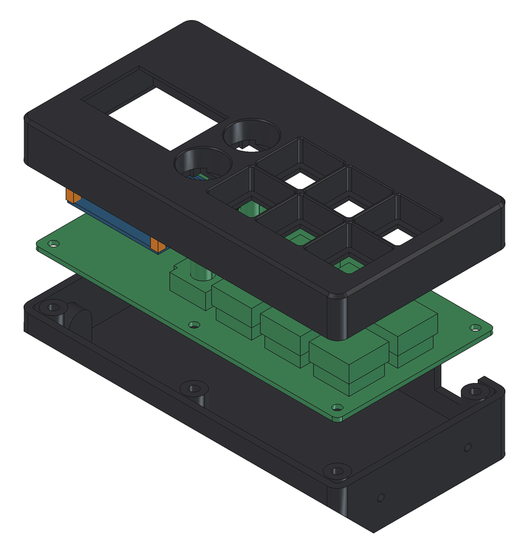
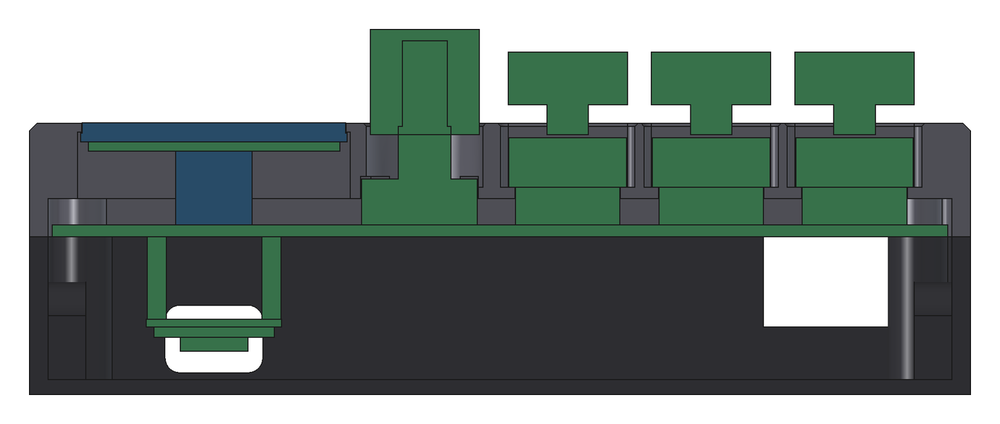
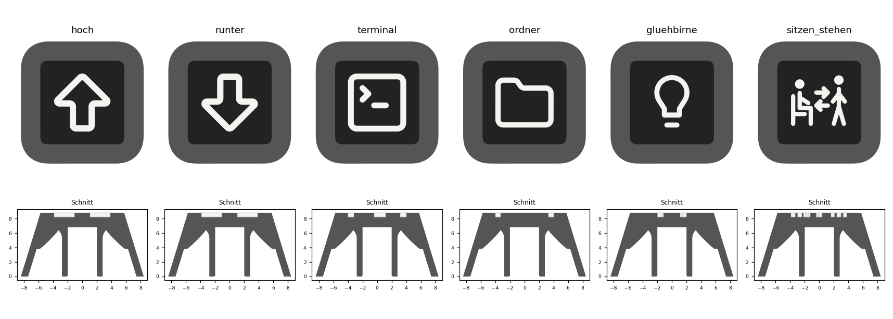
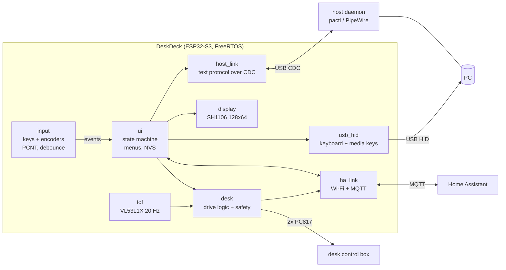

<h1 align="center">DeskDeck</h1>

<p align="center">
  <b>An ESP32-S3 macro pad that lives under the edge of your desk:</b><br>
  per-app volume knobs, a sit/stand desk controller with a laser height sensor, and a Home Assistant link.<br>
  Firmware, PCB and 3D-printed enclosure, all in one repository.
</p>

<p align="center">
  <a href="https://github.com/Elias-m-S/deskdeck/actions/workflows/ci.yml"></a>
  
  
  
  
  <a href="LICENSE"></a>
</p>

<p align="center">
  
</p>

---

## What it does

- **Per-app volume on two knobs.** Each EC11 encoder is bound to an application (Discord, a game, the browser, the master output). A small host daemon talks to PipeWire/PulseAudio over the USB serial port; the OLED shows name, level and a bar for each knob. Press a knob to mute. Without the daemon, the master knob still works through plain USB media keys.
- **Four MX keys.** Keyboard shortcuts over USB HID (e.g. `Super+1`), or special actions: one key toggles the desk between sitting and standing, one triggers a light scene in Home Assistant.
- **Sit/stand desk controller.** Two optocouplers sit in parallel with the desk's own buttons, galvanically isolated from the ESP. A VL53L1X time-of-flight sensor measures the height to the floor. Profiles, calibration and the learned coasting distance are stored in flash. The drive logic is a pure state machine with hard safety limits and a host-side simulation test.
- **Home Assistant over Wi-Fi + MQTT.** The device announces itself through MQTT discovery: a desk-height sensor, sit/stand buttons and a key trigger. HA can push short messages to the display.
- **No buttons needed to flash.** The firmware reboots itself into the ROM bootloader on request; `flash.sh` builds, flashes and restarts in one go.
- **Two mechanical desk buttons** on the same board are wired straight to the desk, so the desk always works, even with the ESP unpowered.

## Gallery

| PCB, bottom side (ESP32-S3 SuperMini, optocouplers, terminal block) | Schematic |
|---|---|
|  |  |

| Enclosure, exploded | Section through display, encoder and keys |
|---|---|
|  |  |

| Two-colour keycaps (3MF, generated from Lucide icons) |
|---|
|  |

## How it works



Every block is its own FreeRTOS task. All UI state belongs to exactly one task and is fed through a single event queue, so there is no shared mutable state to lock.

**Per-app volume.** The device sends `@ADJ +2 Discord` or `@MUTE Discord` over the CDC port. The daemon matches the name against running audio streams (`application.name` / binary) and applies it with `pactl`; it answers with `@LVL <percent> <muted> <active> <name>` and the list of selectable targets, which the device shows in its menu. Levels for apps that are not running are remembered and applied as soon as a stream appears. Protocol: [`firmware/main/host_link.h`](firmware/main/host_link.h).

**Desk control.** Target height = sensor distance + calibrated offset. The logic in [`desk_logic.c`](firmware/main/desk_logic.c) has no hardware access and is exercised against a simulated desk in [`test/desk_sim.c`](firmware/test/desk_sim.c): accuracy after learning the coasting distance, plus every abort case. Safety rules:

| Rule | Value |
|---|---|
| Maximum time per profile move | 20 s |
| After a 2 s spin-up the desk must move per second at least | 8 mm in the right direction |
| Movement in the wrong direction aborts after | 15 mm |
| No fresh sensor reading for | 300 ms -> abort |
| Any user input while moving | stops immediately |
| Outputs | off at boot, never both on at once, pulled down in hardware |

**Home Assistant.** MQTT discovery creates a device *DeskDeck* with the entities desk height (`deskdeck/desk/height`), sit/stand buttons (`deskdeck/cmd/desk`) and a trigger for key 4 (`deskdeck/key/4`). `deskdeck/cmd/toast` shows a short text on the display. Topics: [`firmware/main/ha_link.h`](firmware/main/ha_link.h).

## Repository layout

| Directory | Contents | Details |
|---|---|---|
| [`firmware/`](firmware/) | ESP-IDF project: input, UI, display driver, VL53L1X driver, desk logic, USB composite device, MQTT | [firmware/README.md](firmware/README.md) |
| [`host/`](host/) | Python daemon for per-app volume (PipeWire/PulseAudio via `pactl`), systemd user unit | [host/README.md](host/README.md) |
| [`hardware/`](hardware/) | KiCad project, Gerber ZIP for JLCPCB, BOM, schematic PDF, Python generator that builds schematic + board from one data file | [hardware/README.md](hardware/README.md) |
| [`enclosure/`](enclosure/) | Parametric FreeCAD enclosure (reads the board data from `hardware/`), print-ready STL, two-colour keycaps | [enclosure/README.md](enclosure/README.md) |
| [`docs/images/`](docs/images/) | Renders used in the READMEs | |

## Build one

1. **PCB.** Upload [`hardware/fabrication/deskdeck-gerber-jlcpcb.zip`](hardware/fabrication/) to JLCPCB or any 2-layer fab (119 x 62 mm, 1.6 mm, HASL). Parts are all through-hole, see the [BOM](hardware/fabrication/bom.csv) and the [soldering order](hardware/README.md#assembly-order).
2. **Enclosure.** Print the five STL files in [`enclosure/stl/`](enclosure/stl/) (PETG, no supports) and the keycaps in [`enclosure/keycaps/`](enclosure/keycaps/). Assembly and the drill template for the desk are in [enclosure/README.md](enclosure/README.md).
3. **Firmware.**
   ```bash
   cd firmware
   cp main/secrets.h.example main/secrets.h   # Wi-Fi/MQTT credentials, or leave empty
   idf.py set-target esp32s3 && idf.py build
   ./flash.sh                                   # or: idf.py flash
   ```
   First flash of a blank board: hold BOOT, tap RST, release BOOT, then flash. From then on `flash.sh` reboots the device into the bootloader by itself.
4. **Host daemon** (Linux with PipeWire or PulseAudio):
   ```bash
   sudo apt install python3-serial pulseaudio-utils
   host/install.sh                              # systemd user service, starts at login
   ```
   Then edit `~/.config/deskdeck/config.json` to map knob targets to your applications (`host/deskdeck_daemon.py --list` shows what is playing).
5. **Home Assistant.** Point `MQTT_URI` in `secrets.h` at your broker. The device appears automatically. Create an automation on the key-4 trigger and, optionally, publish feedback to `deskdeck/cmd/toast`.

## Hardware at a glance

| Part | Role |
|---|---|
| ESP32-S3 SuperMini | MCU, native USB (TinyUSB composite: HID + CDC), Wi-Fi |
| 1.3" SH1106 OLED, I2C | Display, flush with the lid |
| 2x EC11 rotary encoder with push button | Volume / menu, mute |
| 6x Cherry MX compatible switches | 4 macro keys + 2 purely mechanical desk buttons |
| VL53L1X (TOF400C module) | Height to the floor, 20 Hz, median filtered, narrowed ROI |
| 2x PC817 optocoupler, 470 R + 10 k | Isolated desk UP/DOWN outputs |
| 3-pole screw terminal | Desk control box (VCC, M1, M2) |

Pin map (all inputs active-low with internal pull-ups):

| Function | GPIO |
|---|---|
| Encoder 1 A / B / switch | 1 / 2 / 4 |
| Encoder 2 A / B / switch | 9 / 10 / 11 |
| MX keys 1-4 | 5, 6, 7, 8 |
| I2C SDA / SCL (OLED + sensor) | 12 / 13 |
| Desk UP / DOWN (optocoupler LEDs) | 44 / 3 |
| On-board WS2812 status LED | 48 |

Everything configurable (pins, key map, encoder targets, desk limits, timings) lives in [`firmware/main/config.h`](firmware/main/config.h).

## Safety

The desk side of the board carries the desk's own control voltage. It is isolated from the ESP by the optocouplers, a copper keep-out and a DRC rule enforcing 0.8 mm clearance; there is no shared ground. Keep it that way. Start with `DESK_DRY_RUN 1` in `config.h`: the complete logic runs, including the sensor, but the outputs never switch. Only after you have verified the wiring, set it to `0` and calibrate the height once from the menu.

## Notes

- The strings shown on the OLED and the Home Assistant entity names are German, the author's UI language. They are plain literals in `ui.c`, `desk_logic.c`, `tof.c` and `ha_link.c`.
- Mechanical dimensions (SuperMini footprint, OLED module, TOF400C cap, EC11 clone body) were measured on the actual parts; the READMEs list what to re-measure before ordering or printing.
- Boards fabricated before the project was renamed carry the silkscreen "ESP32-S3 Stream Deck v2". They are electrically identical to this revision.

## License

MIT, see [LICENSE](LICENSE). It also lists the third-party pieces: the Adafruit 5x7 font, the register sequence from ST's VL53L1X Ultra Lite Driver, Lucide icon outlines on the keycaps, and symbols/footprints from the KiCad libraries.
