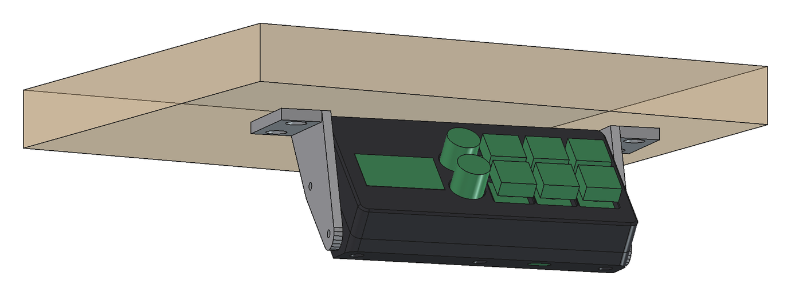
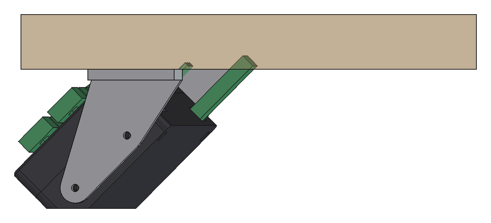
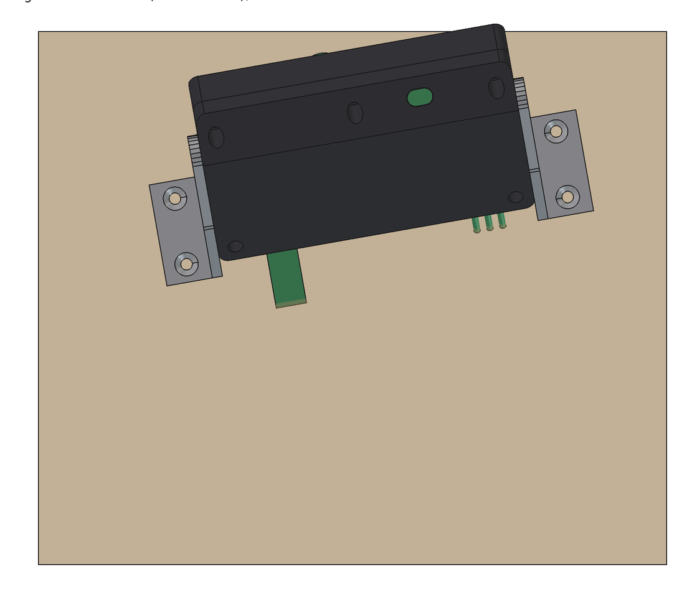
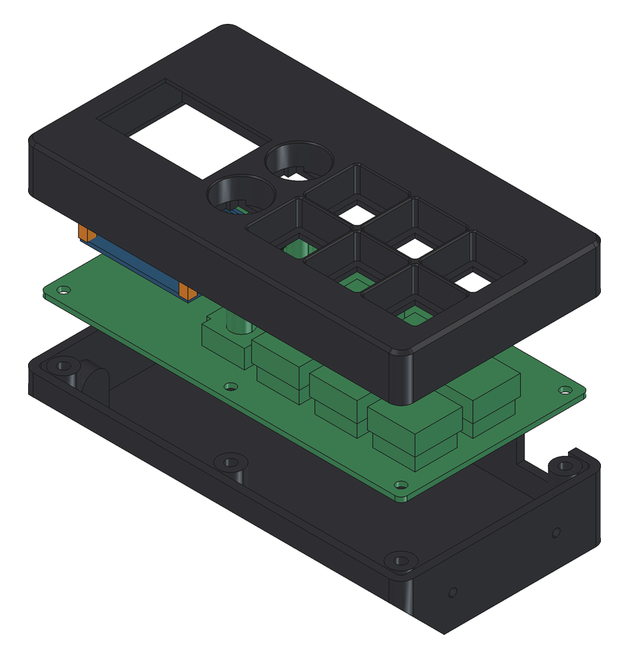
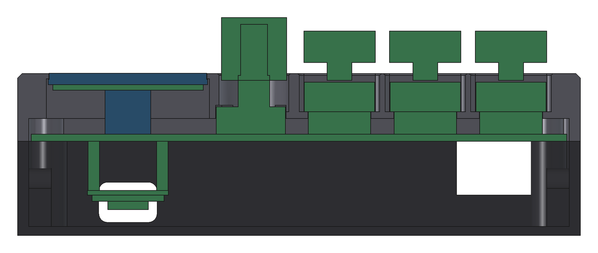
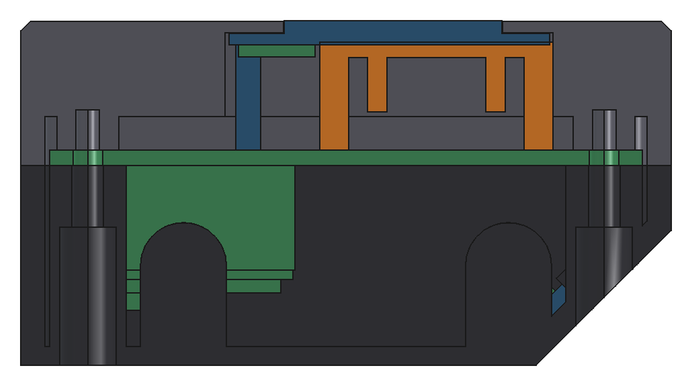
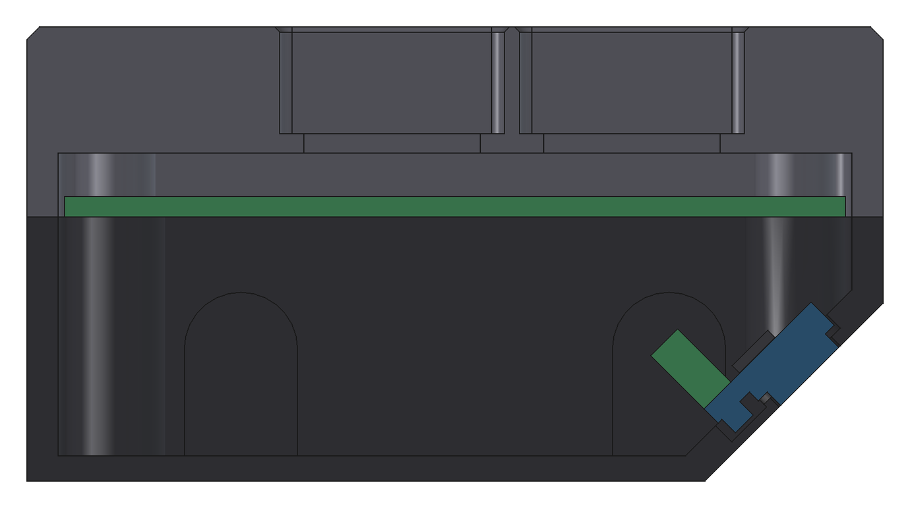
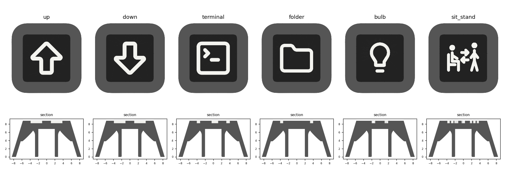

# Enclosure

Parametric enclosure for FreeCAD 1.x, screwed **under the edge of the desk**, to the right of the seat. The tilt is fixed: the keys face 45 deg forward, and the whole assembly is yawed 10 deg about the vertical (to the left) towards the user. The distance sensor clips into a bevel on the bottom edge and looks straight down to the floor when installed. The OLED sits on an 8.5 mm riser, so the whole lid top is raised by 8.5 mm. The glass ends flush with it; keys and knobs sit in their own pockets whose floor is the switch plate.

| Side view (user on the left) | From below: position relative to the desk edge |
|---|---|
|  |  |

| Exploded view | Section through display, encoder, keys |
|---|---|
|  |  |

| OLED retainer in section | Sensor in section |
|---|---|
|  |  |

## Parts (all printable without supports, STL already in print orientation)

| Part | File | Notes |
|---|---|---|
| Lid | `stl/Lid.stl` | top face on the bed. 15.1 mm high, top face 13.5 mm above the PCB. Switch plate 1.5 mm (pocket floor), MX switches clip straight in. Window for the OLED glass, pocket for the OLED PCB below |
| OLED retainer | `stl/OLED_Retainer.stl` | ribs on the bed. U-frame 36.5 x 24.3 x 11.3 mm, pushed into the lid pocket behind the OLED module (crush ribs hold it). The ribs sit under the free edge and both side edges of the module, flex 0.2 mm and press it against the pocket ceiling; the four feet stand on the PCB. Nothing rattles, and pressing on the glass does not bend the module back |
| Tray | `stl/Tray.stl` | floor on the bed. Bevel with a stepped seat for the sensor cap (pocket + oval hole), groove for the pin row and two spring snap hooks, openings for USB and the desk cable |
| Bracket left / right | `stl/Bracket_*.stl` | lying flat. Fixed tilt: two round holes for the tray, two countersunk holes for wood screws into the desktop |

PETG recommended (under the desk, warmth from the PC), 3 walls, 20 % infill.

## Keycaps

`keycaps/{up,down,terminal,folder,bulb,sit_stand}.3mf`, generated with `keycaps.py`. The cap itself was `Symmetrical_Keycaps(2).stl` (16.9 x 16.9 x 8.8 mm, top face 11.5 mm), the legend is inlaid 0.6 mm deep, flush. The source files (blank STL and the Lucide caps) are not part of the repository; to regenerate, put them into `keycaps/`. `freecadcmd keycaps.py preview` only redraws the preview image from the committed 3MF files. Each file is one object made of two parts, cap = extruder 1, legend = extruder 2, lying top face down like the STL. Arrow, terminal and folder are taken from the Lucide `keycaps/*.3mf` (legend outline only), bulb and sit/stand are drawn in the script.

Lid: the pocket floors hang upside down 8.5 mm above the bed, each only ~1.9 mm wide from the pocket wall to the switch hole. That prints without supports, but keep "detect bridges/overhangs" enabled in the slicer and do not force supports. The webs between the keys are 1.2 mm thick and 8.5 mm high: line width <= 0.45 mm so the slicer fits two walls in (check in the preview that the webs are not hollow).

OLED retainer: 100 % infill (it is almost all wall anyway) so the ribs flex evenly.

## Materials

- 5x M3x12 (button or cap head): tray -> PCB -> lid. The screws cut their own thread into the lid bosses
- 4x M3x10 + washer: brackets -> tray (two screws per side, both in round holes)
- 4x wood screw 4x16 countersunk: brackets -> desktop
- female header 1x4, 8.5 mm high, as the OLED riser
- keycaps at most 15.85 x 15.85 mm (see below), knobs 14.5 mm diameter
- **USB-C cable with a 90 deg plug** (see below)

## Assembly

1. **Sensor:** solder wires to the TOF400C (no pin header). Press the module onto the bevel from the inside, cap first into the pocket (lower step) and the oval hole (glass), pin row towards the tray floor (into the groove), until the two snap hooks at the short edges click in. Route the wires along the floor to the back to J2. To remove, push the hooks outwards with a small screwdriver.
2. Lay the PCB with the SuperMini plugged in into the tray. USB-C faces the opening in the rear wall, the desk wires go through the slot.
3. **OLED into the lid:** pull the OLED module out of the riser socket. Lay the lid top face down, put the module glass first into the pocket (glass in the window). Push the OLED retainer feet up behind it into the pocket: the open side of the U faces the pins, the ribs rest on the module edges. The crush ribs hold it.
4. Turn the lid over and set it onto the PCB: the OLED pins go into the riser socket, the retainer feet stand on the PCB. Drive in the 5 M3x12 from below (not too tight, or the thread in the plastic strips).
5. Fit keycaps and knobs.
6. **Brackets to the desk:** the brackets are screwed on at 10 deg to the desk edge, the right front end of the enclosure sits at the desk edge. Drill positions for the wood screws (printed by the script on every run), x to the right along the desk edge from the front left hole, y backwards from the desk edge:

   | Hole | x | y |
   |---|---|---|
   | left front | 0.0 | 68.1 |
   | left rear | 4.5 | 93.7 |
   | right front | 148.7 | 41.9 |
   | right rear | 153.2 | 67.5 |

   Screw the enclosure to the brackets with 4x M3x10. **Then calibrate the height in the menu.**

## Parameters (top of `enclosure.py`)

Change, then run again: in FreeCAD **Macro -> Macros ... -> `enclosure.py` -> Execute**, or on the command line `freecadcmd enclosure.py`. This regenerates `stl/` (FCStd with assembly view, STL) and runs a collision check against the PCB with simplified parts. Board dimensions, holes and part positions come from [`../hardware/generator/design.py`](../hardware/generator/design.py).

| Parameter | Default | Meaning |
|---|---|---|
| `TILT` | 45 deg | 0 = keys face up, 90 = keys horizontal towards the user. The sensor bevel is computed for it |
| `TILT_RANGE` | 0 | 0 = fixed tilt. > 0 = slot in the bracket for +- this many degrees (the sensor then measures at an angle) |
| `YAW` | 10 deg | rotation about the vertical towards the seat (DeskDeck to the right of the user). Only changes the mounting, not the parts |
| `DESK_GAP` | 0 | enclosure hangs lower. Needed for a straight USB plug (about 8 mm at 45 deg) |
| `WALL`, `GAP`, `CORNER_R` | 2.5 / 0.5 / 4 | wall thickness, clearance around the PCB, corner radius |
| `ENC_BODY`, `ENC_BODY_H`, `ENC_CLEARANCE` | 14 x 12 / 6.1 / 0.15 mm | encoder body (14 along the legs) and height, clearance per side. The rectangular cut-out reaches 6.4 mm, above it the round knob pocket starts |
| `ENC_LEGS` | 1.4 / 7.0 mm | protrusion of the 3 legs and the nub towards the OLED side, width of the notch for them (full lid height) |
| `RETAINER_PRELOAD`, `RETAINER_CLEARANCE`, `RETAINER_CRUSH_RIB` | 0.2 / 0.05 / 0.2 mm | OLED retainer: spring travel of the ribs, clearance to the pocket wall, protrusion of the crush ribs. If the OLED still rattles, raise `RETAINER_PRELOAD` to 0.3; if the retainer sits loose in the pocket, raise `RETAINER_CRUSH_RIB` |
| `RETAINER_PIN_CLEAR` | 9.5 mm | side ribs of the retainer end this far in front of the pin edge (components on the back of the module) |
| `DEPTH` | 19 mm | interior below the PCB. SuperMini on sockets + USB-C needs ~15.2 mm |
| `SENSOR_W/H/T`, `SENSOR_X` | 20 x 12 x 1.6, x = 85 | size and position of the TOF400C |
| `SENSOR_STEP`, `SENSOR_STEP_R` | 12 x 8.5 x 1.0 / r 2 mm | lower step of the cap (flush with the edge opposite the pins) and corner radius of its pocket |
| `SENSOR_GLASS` | 10 x 6.5 x 1.5 mm | upper oval (glass), inset ~1 mm all round |
| `SENSOR_POCKET`, `SENSOR_CAP_DY`, `SENSOR_CLEARANCE` | 1.5 / 1.75 / 0.1 mm | pocket depth (>= step height), offset of the cap from the module centre, clearance in pocket and oval |
| `SENSOR_GROOVE` | 16 x 3.6 x 1.8 mm | groove for the pin row (length, width from the pin edge, depth) |
| `HOOK_W`, `HOOK_T`, `HOOK_NOSE`, `HOOK_ROOT` | 4 / 1 / 0.4 / 1.8 mm | snap hooks: width, thickness, nose (0.35 mm reach over the module edge), root depth in the wall. Clicks too weakly: `HOOK_NOSE` 0.5; too stiff: 0.3 |
| `HOOK_Z` | -0.05 mm | underside of the nose above the module back; negative = the nose presses the module slightly into the bevel |
| `HOOK_Y`, `HOOK_CLEARANCE` | -1.4 / 0.05 mm | hook position along the short edge: at the mounting holes (widest point of the PCB, 1.4 mm from the centre towards the cap edge, estimated from a photo); clearance to the module edge |
| `OLED_FLUSH` | True | True = glass flush with the lid top. False = top stays on the plate, with a separate display bezel on top |
| `OLED_RISER` | 8.5 mm | riser under the OLED pin header. With `OLED_FLUSH` the lid top is raised by exactly this value (0 = OLED soldered in directly, flat lid without pockets) |
| `OLED_PCB_T`, `OLED_GLASS` | 1.2 / 35 x 22.8 x 1.4 | OLED PCB thickness, glass W x H x thickness |
| `WINDOW` | 35.1 x 22.9 mm | window for the glass, centred on the glass (tightened after a test print, fits) |
| `NOTCH`, `NOTCH_ROOF` | 12.5 x 4.0 / 0.4 mm | recess above the solder joints of the OLED pin header, remaining material above it (0 = through slot) |
| `KEYCAP`, `KEYCAP_CLEARANCE` | 15.85 / 1.0 mm | keycap outer size, clearance all round in the pocket. Web between the keys = 19.05 - cap - 2 x clearance (1.2 mm) |
| `KNOB_D`, `KNOB_CLEARANCE` | 14.5 / 0.5 mm | knob, clearance all round in the round pocket |
| `POCKET_R`, `POCKET_CHAMFER`, `TOP_CHAMFER` | 1.0 / 0.4 / 1.0 mm | corner radius of the key pockets, chamfers on the pocket rims and the outer edge |
| `M3_TAP` | 2.6 mm | tap hole for self-tapping M3 in PLA/PETG |

## Measure before printing

- **TOF400C:** PCB 20 x 12 x 1.6 mm (measured). The cap has two steps, 2.5 mm high in total (measured). The steps are estimated from a photo, there is no datasheet for the module: lower step about 12 x 8.5 mm, flush with the edge opposite the pins; on top the glass oval 10 x 6.5 mm, inset ~1 mm all round. Assumed step heights: 1.0 + 1.5 mm. The pocket is 1.5 mm deep (12.2 x 8.7 mm), the oval 10.2 x 6.7 mm goes through the rest of the wall. If the lower step is up to 1.5 mm high it fits; the glass then ends roughly flush with the outside. If something binds: raise `SENSOR_CLEARANCE`. The pin row protrudes 1.5 mm at the front, the back is flat (<= 0.2 mm). The PCB thickness decides whether the hooks grip (the nose sits 0.05 mm below the back and presses the module on)
- **OLED:**
  - window in the lid: 35.1 x 22.9 mm, 5.7 to 28.6 mm below the pin edge of the OLED PCB, centred on the module sideways
  - solder joints of the pin header: the notch leaves 0.9 mm above the OLED PCB. Reflow taller joints flatter or set `NOTCH_ROOF = 0` (slot in the top)
  - height: PCB to underside of OLED PCB = 2.5 (plastic spacer) + 8.5 (riser) = 11.0 mm, glass top at 13.6 mm (0.1 mm above the lid). A different riser height: adjust `OLED_RISER`, the lid top moves with it
  - back: the OLED retainer rests on the outer 1.6 mm at the free edge and at both side edges (up to 9.5 mm in front of the pin edge). No components may sit there, mounting holes do not matter
- **Keycaps:** at most 15.85 x 15.85 mm outside (1 mm clearance in the 17.85 mm pocket). Because the cap is narrower than the switch housing (15.6 mm), the skirt must not hit the housing when pressed: it must end at least ~4 mm above the stem underside (`KEYCAP_SKIRT`). In the model the skirt sits 16.0 mm above the PCB at rest (2.5 mm above the pocket rim) and 12.0 mm when pressed (0.4 mm above the switch housing, 1.5 mm inside the pocket). Check on the real switch: press fully, measure stem underside to housing top
- **Encoders (EC11 clone):** measured 14 x 12 mm, 6.1 mm high, the 3 legs and a small nub on top protrude 1.4 mm further towards the OLED side. The shaft is assumed centred (looks slightly off-centre, could not be measured exactly). Cut-out 14.3 x 12.3 mm plus a 1.4 x 7 mm notch, only 0.15 mm clearance: if the encoder is soldered in crooked or the shaft really is off-centre it binds. Then raise `ENC_CLEARANCE`. A genuine Alps would be 12.0 x 11.7 x 4.5 mm
- **Knobs:** 14.5 mm diameter, pocket 15.5 mm (0.5 mm clearance). Larger knobs rub

## USB plug

At 45 deg the USB socket points diagonally up and back towards the desktop. There are only ~29 mm of room. A straight plug with strain relief needs ~40 mm. So either use a **right-angle (90 deg) USB-C cable** or raise `DESK_GAP`. The script prints the available room on every run.
