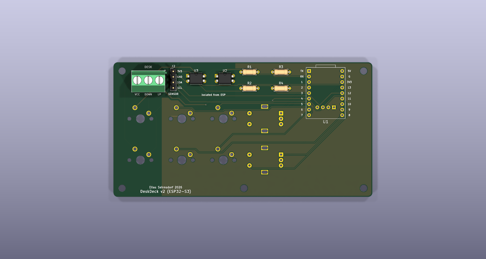
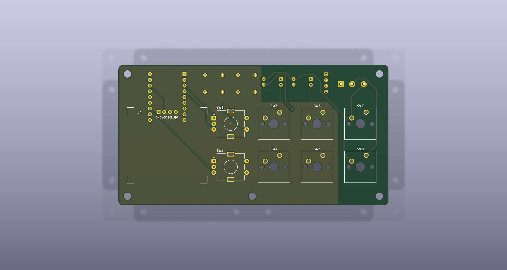

# PCB (rev 2)

2-layer board, **119 x 62 mm**, through-hole parts only (everything is hand-solderable). KiCad 7 format, opens in KiCad 7 to 10 (newer versions ask to convert once).

| Bottom side | Top side |
|---|---|
|  |  |

```
Top side                                           Bottom side (top strip + behind the OLED)
┌──────────────────────────────────────────┐       ESP32-S3 SuperMini on female headers (USB-C towards the top
│ ┌────────┐ (E1)  [1]  [3]  [▲]            │       edge, BOOT/RST reachable from the back), 2x PC817, 4 resistors,
│ │  OLED  │                                │       sensor header (1x4), desk screw terminal (3-pole)
│ └────────┘ (E2)  [2]  [4]  [▼]            │
└──────────────────────────────────────────┘
```

## Desk interface

The desk switches **high side**: the original hand switch connects `VCC` to `M1` (up) or `M2` (down). The desk buttons ▲▼ and the optocoupler outputs sit **in parallel** on these lines, so the buttons always work, even without the ESP.

| Terminal J3 | Desk line | PC817 | Button |
|---|---|---|---|
| 1 `UP` | M1 | U2 pin 3 (emitter) | SW7 |
| 2 `DOWN` | M2 | U3 pin 3 (emitter) | SW8 |
| 3 `VCC` | VCC | U2 + U3 pin 4 (collector) | SW7 + SW8 |

The nets `DESK_UP`, `DESK_DN`, `DESK_VCC` are **galvanically isolated from the ESP**. They belong to the net class `Desk`, and the DRC rule in `deskdeck.kicad_dru` demands **>= 0.8 mm** clearance to everything on the ESP side. There is deliberately no GND pour in the desk area.

rev 1 -> rev 2: `DESK_GND` -> `DESK_VCC`, pins 3 and 4 swapped on U2/U3, isolation clearance 0.25 -> 0.8 mm, silkscreen with >= 0.15 mm line width.

## Verification status (rev 2)

- Schematic netlist, board and `generator/design.py` compared automatically (`generator/check.py`): **identical**
- DRC: **0 unconnected items, 0 clearance, courtyard or silkscreen errors** (tracks 0.3 mm, clearance 0.25 mm, vias 0.7/0.35 mm). KiCad 8+ additionally reports the SuperMini socket pins inside the OLED courtyard, which is intentional: those pins are clipped flush, see the assembly order.
- Isolation clearance desk <-> ESP measured (`generator/iso.py`): **0.80 mm**
- GPIOs cross-checked against `firmware/main/config.h`: encoders 1/2/4 and 9/10/11, keys 5-8, I2C 12/13, desk 44/3
- Gerbers rendered independently and inspected; drill files separated (PTH/NPTH)
- Tested on a breadboard: optocouplers, desk buttons in parallel, manual drive
- Measured on the real parts: SuperMini pinout (`TX RX 1-7` / `5V GND 3V3 13-8`, USB up), row pitch ~15.2 mm, OLED pins `GND VCC SCL SDA`

## Ordering (JLCPCB or similar)

1. Upload `fabrication/deskdeck-gerber-jlcpcb.zip`
2. Defaults: 2 layers, 1.6 mm, HASL, any colour
3. The size is detected from the file (119 x 62 mm)

## Parts

See [`fabrication/bom.csv`](fabrication/bom.csv). Apart from the modules (SuperMini, OLED, TOF400C, encoders, switches) you only need small parts: 2x female header 1x9, 2x pin header 1x4 (OLED + sensor), 3-pole screw terminal 5.08 mm, 2x 470 R, 2x 10 k, M3 screws/stand-offs.

## Assembly order

Flat parts first so the board lies flat while soldering:

1. **Bottom side:** resistors R1-R4 -> PC817 (notch/dot = pin 1, see silkscreen) -> pin header J2 -> screw terminal J3 (cable entry towards the top edge)
2. **Bottom side:** 1x9 female headers for the SuperMini. Tip: keep the module plugged in while soldering the headers, then they sit straight.
3. **Top side, under the OLED:** clip the 6 lowest pins of the SuperMini headers (the bottom 3 of each row) flush and cover the spot with Kapton tape. The OLED later sits only ~2.5 mm above the board.
4. **Top side:** solder the OLED **directly** (no socket, so the glass ends up flush with the lid): a normal 1x4 pin header, plastic spacer resting on the board, clip the short pin ends flush on top of the OLED. Align the OLED level, solder one pin, check, then the rest.
5. **Top side:** encoders, finally the MX switches (best with the lid clipped on as a switch plate, then they sit exactly)

**Desk cable:** 3 wires to J3: `UP` = M1, `DOWN` = M2, `VCC` = desk VCC.
**Sensor:** 4-wire cable from J2 to the TOF400C, by label: `3V3`->`VIN`, `GND`->`GND`, `SDA`->`SDA`, `SCL`->`SCL`.

## Files

```
deskdeck.*        KiCad project (schematic, board, project symbol/footprint libraries)
fabrication/      Gerber ZIP, schematic PDF, BOM
generator/        Python scripts that generate schematic + board from design.py (KiCad 7 + Freerouting)
```

The enclosure ([`../enclosure/`](../enclosure/)) imports `generator/design.py` for the board outline, holes and part positions.

### Generator

`design.py` holds the circuit as data: parts, footprints, positions and the pin-to-net map. `gen_sch.py` and `gen_pcb.py` turn it into a schematic and an unrouted board (so both match by construction), `route.py` runs Freerouting and imports the result with GND pours, `check.py` runs DRC and compares schematic, board and `design.py`, `iso.py` measures the isolation clearance. `gen_pcb.py`/`route.py` use the KiCad 7 pcbnew Python API. If you continue by hand in KiCad, the KiCad files are the source from then on, not `design.py`.

Boards fabricated before the project was renamed carry the silkscreen "ESP32-S3 Stream Deck v2"; the copper is identical.
